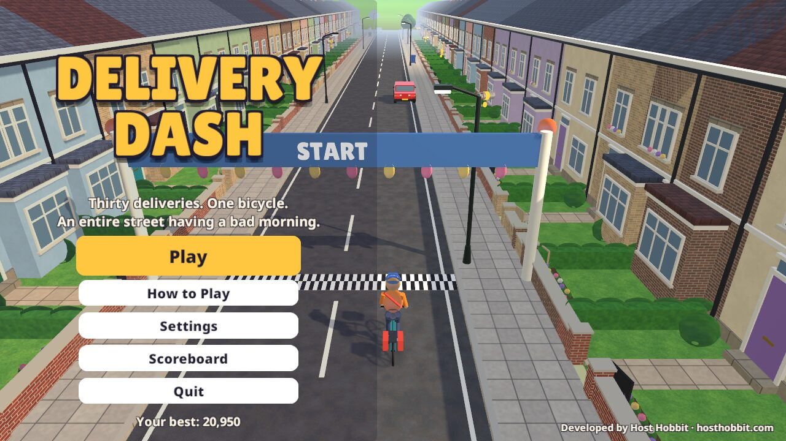
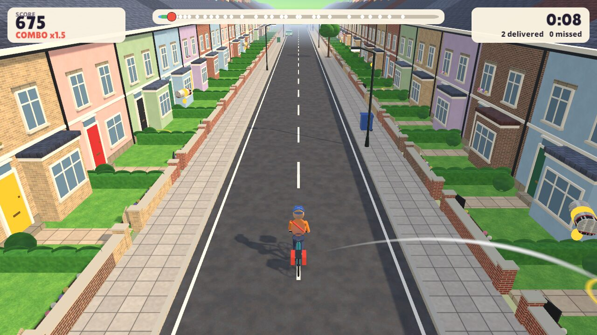
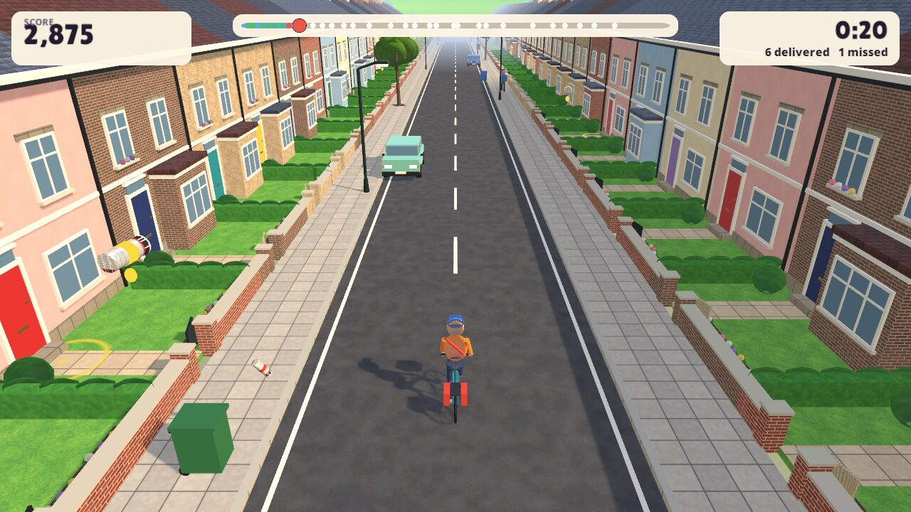
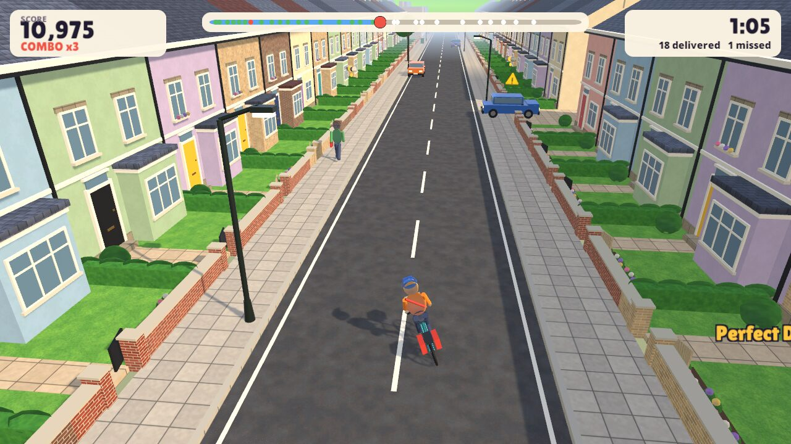
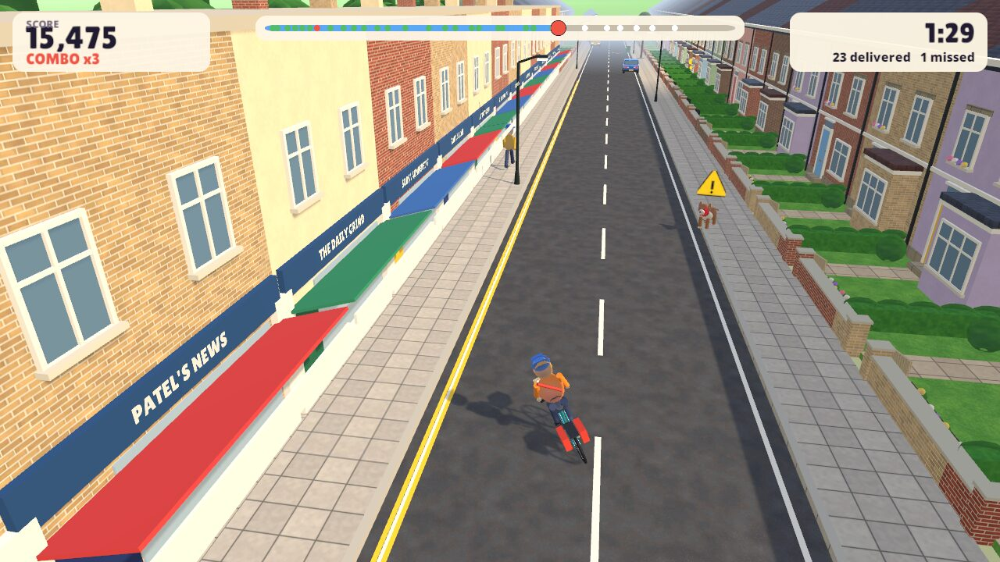
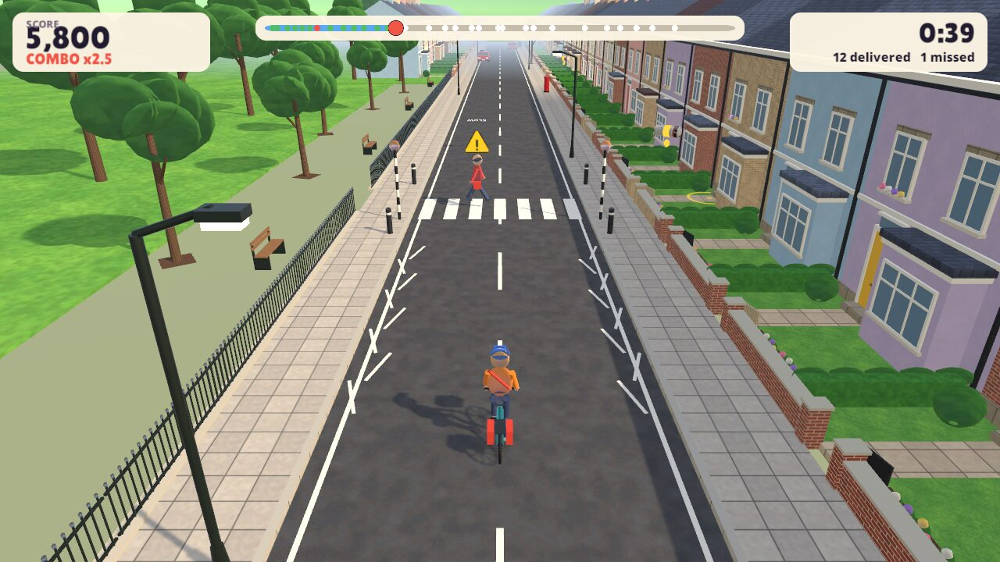
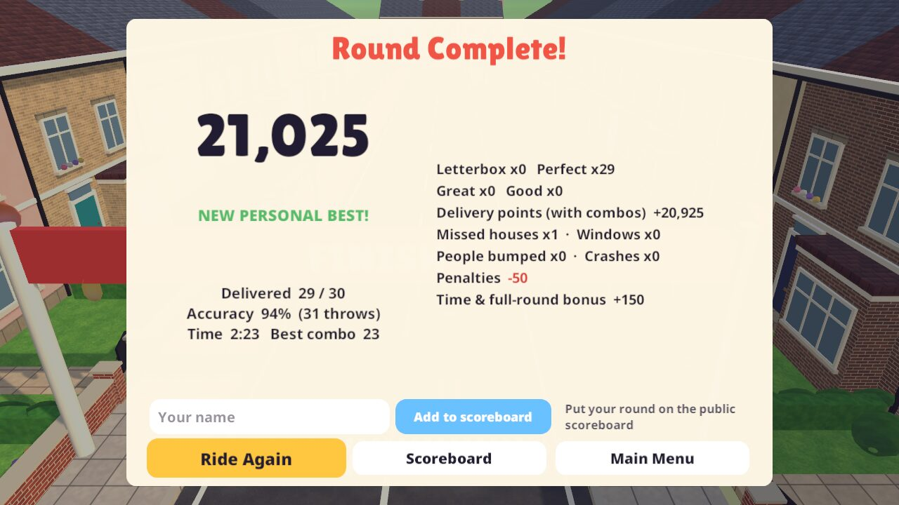

# Delivery Dash

**Thirty deliveries. One bicycle. An entire street having a bad morning.**

A stylised 3D arcade game made in Unity. You ride a paper round down a British terraced street and throw newspapers onto doorsteps. Along the way are wheelie bins, potholes, a dog who takes his job very seriously, a car reversing out of a driveway and people stepping onto the zebra crossing. Land papers close to the door to build a combo, finish under par for a time bonus, and put your round on the public scoreboard.

### ▶ [Play it in your browser](https://hosthobbit.github.io/delivery-dash/)

Developed by [Host Hobbit](https://hosthobbit.com).



| | |
|---|---|
|  |  |
|  |  |
|  |  |

These screenshots were taken by the automated QA run (`./qa.sh`) of the Linux build. It uses software rendering, so they show the game exactly as built, but not how smoothly it runs on a real graphics card.

## How to play

The bike rolls along by itself. Steer it, speed it up or slow it down, and throw papers at the houses with a **glowing marker**. Those are your subscribers (30 of them on a route of about 880 m). Houses without a marker aren't on your round.

| Action | Keyboard and mouse | Gamepad |
|---|---|---|
| Steer | A / D or ← → | Left stick |
| Pedal faster | W or ↑ | Right trigger |
| Brake | S or ↓ | Left trigger |
| Aim | Mouse pointer | Right stick (or automatic) |
| Throw | Hold left mouse to charge (longer = further), let go | Hold A, let go |
| Keyboard-only throw | Q / E to pick a side, hold Space, let go | LB / RB to pick a side |
| Bell | B | Y |
| Pause | Esc or P | Start |

- While a throw is charging you see its **exact** arc and landing ring. The paper follows the same maths, so it lands where the ring shows. A little aim assist pulls the ring onto a nearby doorstep, and the arc stops short if a wall or tree is in the way.
- Keyboard keys can be rebound in **Settings** (Keyboard controls). Changes are saved.
- First time playing? A short practice stretch teaches riding and throwing before the countdown. You can replay it from Settings.

### Scoring

| Event | Points |
|---|---|
| Good (anywhere in the front garden) | 100 |
| Great (near the door) | 200 |
| Perfect (on the doorstep) | 300 |
| Through the letterbox | 400 |
| Combo multiplier | ×1 + 0.25 per delivery in a row, up to ×3 |
| Missed subscriber | −50 |
| Broken window | −150 |
| Hitting a pedestrian (with the bike or a paper) | −200 |
| Crash | −100 |
| Every subscriber delivered | +1000 |
| Under par (2:30) | +25 per second |

Any penalty resets the combo. The score never goes below zero.

### Public scoreboard

At the end of a round you can enter a name (2–16 characters) and add your score to the public scoreboard. Your best score per name is kept. You can also view the top 20 from the title screen.

The game doesn't just send a number. It sends the round's events (each delivery and its grade, misses, windows, people, crashes) plus the time, and the server **replays the scoring rules** on them. The server code is [`server/delivery-scores.php`](server/delivery-scores.php), hosted on hosthobbit.com. It rejects:

- scores that don't match the replay;
- rounds where deliveries plus misses don't equal 30;
- impossibly fast times;
- unsuitable names.

It is also rate-limited. This stops typed-in scores, but a determined cheater could still fake a plausible event list. That's acceptable for a fun arcade board.

## Project facts

- **Unity 6000.6.3f1** (Unity 6.6, not an LTS release; it's the editor this was built with) and the **Universal Render Pipeline**.
- **Packages:**
  - `com.unity.render-pipelines.universal` 17.6.0
  - `com.unity.inputsystem` 1.20.1 (the new Input System only; the old Input Manager is off)
  - `com.unity.cinemachine` 6.6.0 (the Cinemachine 3 API: `CinemachineCamera`, `CinemachineFollow`, impulse shake)
  - `com.unity.ugui` 2.6.0
  - `com.unity.test-framework` 1.8.0
- **Everything is generated from code.** An editor script builds all the textures, meshes, materials, prefabs, render pipeline assets and the scene. So the repository is small and a regenerate always gives the same street. There are no imported 3D models, textures or sounds. All audio is synthesised at runtime.
- **Graphics presets:** Low, Medium and High, each with its own URP asset. Settings also has music and sound volume, camera shake on/off and practice on/off. The browser version starts on Medium.

### Layout

```
Assets/DeliveryDash/
  Scripts/Core       scoring rules, delivery judging, ballistics, route ledger (no Unity dependencies, unit tested)
  Scripts/Bike       kinematic bike controller and visuals (lean, pedalling, crash tumble)
  Scripts/Throwing   charge/aim/preview, newspaper flight, paper pool
  Scripts/Hazards    pedestrian, dog, reversing car, warning signs
  Scripts/World      houses, windows, letterboxes, potholes, route manager
  Scripts/Game       game flow, input actions and rebinding, settings, effects, QA driver
  Scripts/UI         runtime-built uGUI: menus, HUD, pause, results, scoreboard
  Scripts/Audio      synthesised sound effects and music
  Scripts/Net        public scoreboard client
  Editor/            DeliveryDashBuilder (menus and batch builds), StreetBuilder, Prefabs, MeshKit, TextureKit
  Tests/EditMode     unit tests
Assets/WebGLTemplates/DeliveryDash   browser loader page
server/delivery-scores.php           public scoreboard (PHP + SQLite)
```

## Open, play and build

1. Install Unity **6000.6.3f1** with Linux Build Support and/or Web Build Support. Add Windows or Mac support if you want those desktop builds.
2. Open the folder in Unity Hub, open `Assets/DeliveryDash/Scenes/DeliveryDash.unity` and press Play.
3. The generated assets (`Assets/DeliveryDash/Generated/`) and the scene are committed so the project opens ready to play. After changing anything in `Editor/`, rebuild them with **Delivery Dash → Build Everything (assets + scene)**.

Command-line builds (they regenerate everything first):

```bash
./build.sh        # Linux desktop build  -> Build/Linux/DeliveryDash.x86_64
./play.sh         # run it
./build-web.sh    # browser build        -> Build/WebGL/  (serve over http, e.g. python3 -m http.server)
```

Both scripts expect the editor at `~/Unity/Hub/Editor/6000.6.3f1/Editor/Unity`; set `UNITY=/path/to/Unity` to override. A Windows or Mac build works from **File → Build Profiles** after generating. Only Linux and WebGL have been built and tested.

## Testing (what was actually checked)

All automated checks run headless, without a GPU (software rendering on the CPU), so they can't disturb the desktop:

- **Unit tests:** 13 EditMode tests cover scoring, combos and their cap, penalties resetting the streak, the score never going negative, finish bonuses, the server-replay matching the live score, accuracy, delivery grades, each house counting once, misses, route completion, and the trajectory preview matching the paper's flight. All pass.
  ```bash
  Unity -batchmode -nographics -projectPath . -runTests -testPlatform EditMode -testResults Logs/tests.xml
  ```
- **Full playthrough:** `./qa.sh <dir>` runs the Linux build with a bot that rides the route, dodges hazards and throws at every subscriber, taking screenshots along the way. Latest result: 29 of 30 delivered, 1 missed, 0 crashes, 0 windows, 0 people hit, route time 2:23, score 21,025, no exceptions.
- **Practice:** `MODE=practice ./qa.sh <dir>` plays through the tutorial until the countdown starts and checks that it is saved as done. It passes.
- **Input:** `MODE=input ./qa.sh <dir>` drives the menus and the bike with a virtual keyboard and a virtual gamepad. The 18 checks cover menu focus, starting with Enter, steering (D and ←), speeding up (W), braking (S), throwing (Space), pausing and resuming with Esc (no riding while paused), steering, throwing, pausing and resuming with a gamepad, quitting to the menu, and restarting rounds. All 18 pass. Key rebinding was not covered by the automated test.
- **Browser:** `node web-qa.mjs "http://localhost:PORT/?autoplay" <dir>` loads the WebGL build in headless Chromium (SwiftShader). It checks that the game starts, that the public scoreboard answers the page, and runs the same bot.
- **Scoreboard server:** tested live with valid rounds, a tampered score, an impossible round and a too-fast time. Test entries were removed.

**Not yet tested:** performance on real graphics hardware. The QA machine's GPU is deliberately kept out of automated runs, and software rendering reaches only a few frames per second at 720p. That number reflects the CPU renderer, not the game. The scene is built to be light (about 350 houses with LOD groups, simple lit materials, pooled papers, three quality presets), but frame rates on real devices haven't been measured. Also untested: a real gamepad, though virtual gamepad input was checked.

## Known limitations

- Made for keyboard and mouse or a gamepad. There are no touch controls, so phones and tablets need a Bluetooth controller or keyboard.
- One handcrafted route. The street layout is generated, but it's the same every time, which keeps the scoreboard fair.
- The browser version is about 17 MB to download and needs WebGL 2. It stores settings and your personal best in the browser.

## Credits

See [ATTRIBUTION.md](ATTRIBUTION.md). Game design, code, models, textures, sound and music are original to this project. Fonts are used under the SIL Open Font License.
